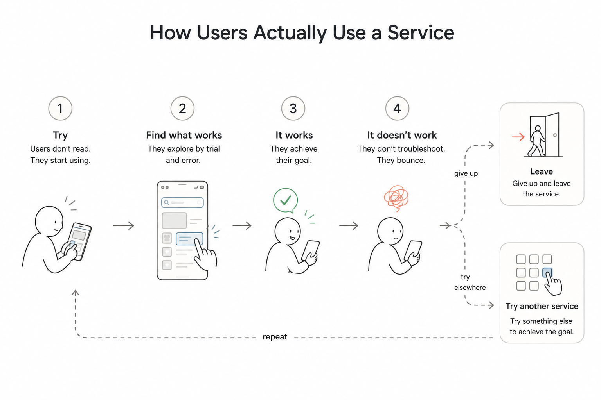

import DropdownSelectionDemo from './demos/dropdown-selection/index.astro';
import MinimalismParadoxChart from './demos/minimalism-paradox/index.astro';

사용자가 권한이 없거나 특정 조건을 채우지 못해 기능을 쓸 수 없을 때,
서비스 제공자는 '어차피 못 쓰는 기능이니 편의를 위해 아예 숨기자'고 결정하곤 한다.
깔끔하고 논리적인 판단처럼 보이지만, 사용자 관점에서는 오히려 혼란과 불신을 유발하는
UX 안티패턴이 되기 쉽다. 왜 그런지, 그렇다면 무엇을 숨기고 무엇을 숨기지 말아야 하는지 살펴본다.

---

## 화면에서 지우면 생기는 일들

### 문제 1. 사용자는 숨겨진 기능이 있다는 사실조차 모른다

서비스 제공자는 전체 구조를 꿰고 있어 일부를 숨겨도 문제없다고 생각하기 쉽다.
하지만 사용자는 눈앞에 드러난 기능만으로 서비스를 인지할 수밖에 없으며,
화면에 보이지 않는 기능은 애초에 존재하지 않는 것과 다름없다.

물론 목적이 뚜렷하거나 비슷한 서비스를 써본 사용자는 전후 맥락을 통해 
어떤 기능이 숨겨져 있고 왜 보이지 않는지를 짐작하기도 하지만,
대부분은 오직 눈앞에 보이는 것만으로 판단할 수밖에 없다. 
결국 화면에 보이지 않는 기능은 사용자에게 없는 기능이나 마찬가지다.
숨겨진 기능이 더 있을 거라 생각하기보다는, 
그저 "이 서비스에서는 지원하지 않는구나" 하고 지나쳐 버릴 뿐이다.

### 문제 2. 사용자를 추측하고 고민하게 만든다

분명히 있어야 할 기능인데 눈앞 어디에도 보이지 않으면, 사용자는 화면을 헤매며 
혼자 이런저런 생각을 하기 시작한다. '내가 권한이 부족한가?', '결제해야 쓸 수 있나?', 
'일시적인 오류인가?', '다른 메뉴에 숨어 있나?'.
결국 명확한 이유를 알 수 없어 불필요한 추측과 고민에 빠지게 된다.

사용자를 고민하게 만드는 UI는 결코 좋은 설계라 할 수 없다.
<ruby>스티브 크룩<rt lang="en">Steve Krug</rt></ruby> 의
『<cite>[(사용자를) 생각하게 하지 마!](https://www.aladin.co.kr/shop/wproduct.aspx?ItemId=49274393)</cite>』
에 따르면 대부분의 사용자는 서비스를 이해하는데 노력하지 않고 대충 눈앞에 보이는걸 이것 저것
눌러보며 <ruby>임기웅변<rt lang="en">Muddle through</rt></ruby> 식으로 목적을 찾아간다.
그러다 대충 시도해 본 방식이 통하지 않으면, 원인을 찾아 해결하려 하기보다 미련 없이 서비스를
포기하고 이탈한다.

### 문제 3. 자신의 상태와 다음 행동을 판단할 기준을 잃는다

UI 는 사용자가 지금 어디에 있고, 어떤 상태이며, 다음에 무엇을 할 수 있는지를 결정할 수 있는
**판단 및 행동 기준**을 제공해야 한다. 이는
[제이콥 닐슨](https://ko.wikipedia.org/wiki/%EC%A0%9C%EC%9D%B4%EC%BD%A5_%EB%8B%90%EC%8A%A8)이 강조한
<ruby>시스템 상태의 가시성<rt lang="en">Visibility of System Status</rt></ruby> 의 핵심이기도 하다.

> "시스템은 적절한 피드백을 통해, 합리적인 시간 안에 사용자에게 현재 무슨 일이 일어나고 있는지 항상 알려주어야 한다."  
> — <cite>[Jakob Nielsen, 10 Usability Heuristics](https://www.nngroup.com/articles/ten-usability-heuristics/)</cite>

버튼은 누르기 위해, 목록은 고르기 위해 존재하지만, 그것은 어디까지나 1차적인 기능일 뿐이다.
화면에 놓인 요소들은 단순히 동작하는 것을 넘어, 지금 어떤 상황이고 다음에 무엇을 할 수 있는지 알려주는 가이드가 되어야 한다.
만약 이를 고려하지 않고 요소를 화면에서 임의로 제거해 버리면, 사용자는 자신의 현재 상태를
비교할 기준을 잃게 되고, 결국 내가 어디에 있는지, 무엇이 바뀌었는지, 다음에 무엇을 선택해야 하는지를
판단하지 못하는 <ruby>인지적 혼란<rt lang="en">Cognitive Confusion</rt></ruby>에 빠지게 된다.

대표적인 예로 <a href="https://www.atlassian.com/ko/software/jira" rel="nofollow">Atlassian Jira</a> 에서 
사용되는 드롭다운 셀렉트 박스 UI를 들 수 있다. 
특정 항목을 선택하면 해당 옵션이 다음 목록에서 완전히 사라져 버리는 방식을 취하고 있다.
선택된 항목은 다시 선택할 수 없으니 목록에서 제거하는 것이 합리적이라고 생각했겠지만,
이로 인해 사용자는 자신이 이미 무엇을 선택했는지, 그리고 다음에 무엇을 선택해야 하는지를 
비교할 기준을 잃어버린다.

이러한 차이를 직관적으로 확인해 볼 수 있도록 아래와 같이 데모를 구성했다. 
왼쪽은 항목을 선택하면 목록에서 숨겨버려 상태의 연속성을 끊어버리는 방식이고, 
오른쪽은 선택된 항목을 하이라이트로 강조해 보여주어 현재 상태와 남은 선택지를 
한눈에 비교할 수 있도록 개선한 방식이다.

<DropdownSelectionDemo />

## 미니멀리즘의 역설: 화면에서 숨길수록 인지 부하는 늘어난다

이러한 무분별한 단순화 현상의 바탕에는 UI 디자인에서 자주 범하는 
<ruby>미니멀리즘의 역설<rt lang="en">Paradox of Minimalism</rt></ruby> 이 
자리 잡고 있다. 화면을 깨끗하게 정리하겠다고 기능을 숨길수록, 
역설적이게도 사용자는 더 많은 생각과 고민을 해야 한다. 
화면은 단순해졌지만, 그만큼 사용자가 찾아 헤매고 추측해야 하는 부담은 커지기 때문이다.

실제 연구 결과도 이를 뒷받침한다. 닐슨 노먼 그룹의 조사에 따르면, 화면을 미니멀하게 
단순화했을 때 사용자의 탐색 시간과 작업 완료 시간은 오히려 크게 악화되는 것으로 나타났다.

<MinimalismParadoxChart />

**화면 단순화(미니멀 UI)에 따른 사용성 지표 변화**

<figure class="fixedTable">
| 평가 지표 | 미니멀 UI 적용 시 변화 | 사용자 경험(UX)에 미치는 영향 |
| :--- | :--- | :--- |
| <ruby class="blockRuby">기능 발견 가능성<rt lang="en">Discoverability</rt></ruby> | **48% 감소** | 화면에 노출되지 않은 기능은 존재 자체를 인지하지 못함 |
| <ruby class="blockRuby">작업 완료 시간<rt lang="en">Task Completion Time</rt></ruby> | **21% 증가** | 숨겨진 요소를 찾고 추측하느라 불필요한 작업 시간 소모 |
| <ruby class="blockRuby">시선 고정 및 탐색 시간<rt lang="en">Fixation Duration</rt></ruby> | **22% ~ 25% 증가** | <ruby>시각적 단서<rt lang="en">Signifier</rt></ruby> 부족으로 요소를 이해하느라 망설임 |

  <figcaption class="references">
    <ul>
      <li>
        <cite>
          <a 
            href="https://www.nngroup.com/articles/hamburger-menus/"
            target="_blank"
            rel="noopener noreferrer">Hamburger Menus and Hidden Navigation Hurt UX Metrics - Nielsen Norman Group</a>
        </cite>
      </li>
      <li>
        <cite>
          <a
            href="https://www.nngroup.com/articles/flat-design-best-practices/"
            target="_blank"
            rel="noopener noreferrer">Flat-Design Best Practices - Nielsen Norman Group</a>
        </cite>
      </li>
    </ul>
  </figcaption>
</figure>

결국 화면을 비워내는 것 자체가 목적이 된 단순함은 사용자를 편하게 만드는 것이 아니라, 
도리어 단서와 맥락을 은폐하여 서비스 이탈을 부추기는 불친절한 장애물이 될 뿐이다.

---

## 무엇을 숨기고, 무엇을 숨기지 말아야 하는가

그렇다고 모든 것을 항상 노출해야 한다는 것은 아니다. 분명히 숨겨야 할 것도 있다.  
어떤 것을 숨기고 어떤 것을 숨기지 말아야 할까?

### 숨겨야 하는 유형

숨기지 않으면 보안상 문제가 되거나, 사용자가 어떤 방법으로도 접근할 수 없는 기능과 정보는 
화면에서 숨기는 것이 바람직하다. 단, "지금은 쓸 수 없지만 조건을 충족하면 사용할 수 있는" 
기능까지 숨겨서는 안 된다. 기능의 존재를 먼저 알리고, 조건이 채워졌을 때 활성화되도록 이끌어야 한다. 
'숨김'은 사용자가 영구적으로 접근할 방법이 전혀 없을 때만 허용되는 마지막 선택이어야 한다.

| 유형 | 근거 | 예시 |
| --- | --- | --- |
| 보안상 노출하면 안 되는 것 | 노출 자체가 보안 취약점이 된다 | 관리자 페이지 접근 경로 |
| 영구적으로 무관한 것 | 획득 경로가 없어 표현해도 할 수 있는 행동이 없다 | 해당 국가에 제공되지 않는 결제 수단 |
| 판단과 무관한 노이즈 | 현재 상태·다음 선택과 관련이 없어 인지 부하만 늘린다 | 내부 에러 로그 |

### 숨기지 않아야 할 유형

반면, 조건을 갖추면 앞으로 사용할 수 있는 기능이나 현재 상태를 알려주는 기능은 
결코 숨겨서는 안 된다.

| 유형 | 근거 | 예시 |
| --- | --- | --- |
| 조건을 갖추면 사용할 수 있는 기능 | 지금 못 쓸 뿐 접근할 경로가 있다 | 구매 후 사용하는 유료 이모티콘 |
| 순서상 나중에 진행되는 기능 | 앞 단계를 끝내면 접근할 수 있다 | 필수 약관 동의 전의 다음 단계 |
| 현재 상태를 알려주는 기능 | 지우면 완료 여부를 확인할 수 없다 | 이미 내려받은 쿠폰의 [발급 완료] 버튼 |

결국 판단 기준은 하나다. **"사용자에게 접근할 방법이 열려 있는가."**  
접근할 수 있는 기능이라면 결코 화면에서 지워서는 안 된다. 그렇다면 단순히 숨기지 않는 것을 넘어, 화면에 어떻게 드러내야 할까?

---

## 기능을 숨기지 않고 보여주는 방법

UX에서의 단순함은 화면에서 요소를 무작정 숨기는 것이 아니라, 사용자가 지금 어떤 상황인지 쉽게 이해할 수 있게 만드는 것이다.
사용자가 특정 기능을 당장 쓸 수 없더라도, 그 기능을 숨기는 대신 **현재 상태를 있는 그대로 보여주어야 한다.**
이를 제대로 구현하기 위해서는 다음 세 가지가 함께 갖춰져야 한다.

### 1. 비활성화 (Disable)

<dfn><ruby>비활성화<rt lang="en">Disable</rt></ruby></dfn>란 기능을 화면에서 지우는 대신, 
버튼이나 메뉴를 흐린 회색조로 표시하거나 자물쇠 아이콘을 덧붙여 
'존재하지만 지금은 누를 수 없는 상태'로 제자리에 남겨두는 것을 말한다.
당장 쓸 수 없는 기능이라도 무작정 숨기지 않고 이렇게 비활성 상태로 자리를 지키게 두는 편이 훨씬 안전하다. 
비활성화된 요소는 사용자에게 세 가지 중요한 사실을 전달하기 때문이다.

1. 이 기능은 **존재한다.** (기능 인지)
1. 지금은 **사용할 수 없다.** (현재 제약)
1. 특정 조건을 갖추면 **사용할 수 있다.** (잠재적 가능성)

즉, 비활성화는 단순히 사용을 막는 제약이 아니라, 사용자에게 서비스의 전체 기능과 가능성을 
자연스럽게 안내하는 방법이다. 숨김은 기능의 존재 자체를 지워버리지만, 
비활성은 화면의 구조와 흐름을 그대로 지켜준다.

<aside class="postSubnote">
  

    물론 모든 경우에 비활성화가 정답인 것은 아닙니다. 입력 폼의 제출 버튼처럼 시도를 먼저 허용해야 하는 예외도 있고, 웹 접근성이나 명도 대비처럼 세심하게 다루어야 할 기술적 디테일도 많습니다. 올바른 비활성화 구현 방법과 패턴에 대해서는 추후 별도의 포스트에서 자세히 다루겠습니다.
  

</aside>

### 2. 이유 설명 (Explain)

비활성 상태로 두는 것만으로는 충분하지 않다.
사용자가 지금은 사용할 수 없다는 사실을 알아차렸더라도, **왜 사용할 수 없는지** 
그 이유를 이해하지 못하면 또 다른 의문과 혼란이 생긴다. 
이때 비활성화된 요소 주변에 안내 문구를 두거나, 
마우스 클릭과 같은 상호작용이 일어나는 시점에 명확한 이유를 안내해 주는 것이 좋다.

- "구매 후 사용할 수 있는 이모티콘입니다."
- "필수 약관에 동의해야 합니다."
- "본인 인증이 필요합니다."

이 문구는 단순한 경고나 오류 안내가 아니다. 사용자는 이 메시지를 통해 
불필요한 추측을 멈추고, 다음에 무엇을 해야 할지 스스로 판단할 수 있게 된다.

### 3. 경로 안내 (Guide)

사용자에게 이유를 설명하는 것만으로는 부족할 수 있다. 왜 사용할 수 없는지 알게 되었더라도,
어디에서 어떻게 해야 하는지 모르면 다음 행동으로 이어지기 어렵다. 이유를 안내했다면, 
그 조건을 충족할 수 있는 페이지로 이동하는 링크나 버튼도 함께 제공해야 한다.

- "구매 후 사용할 수 있습니다." → 바로 옆에 **[구매하기]** 버튼 제공
- "필수 약관에 동의해야 합니다." → 해당 **[약관 확인하기]** 링크 연결
- "본인 인증이 필요합니다." → **[본인 인증하기]** 버튼 연계

## 숨김은 단순화가 아니라 정보 손실이다

화면에서 요소를 지우는 건 언뜻 가장 손쉬운 정리처럼 보이지만, 만드는 사람의 눈앞만 깨끗해질 뿐 사용자는 기억하던 자리를 잃고 방황하게 된다.

사용자는 화면의 글자를 일일이 읽기보다 익숙한 자리를 손과 눈으로 기억하며 움직이기 마련이다. 당장 쓸 수 없더라도 원래 있던 자리를 지켜주고, 왜 안 되는지와 어떻게 해야 하는지를 솔직하게 보여줄 때 비로소 화면을 안심하고 신뢰할 수 있다.

단순함은 화면을 무작정 비운다고 만들어지지 않는다. 사용자가 지금 어떤 상황이고 다음에 무엇을 할 수 있는지 고민 없이 알아차릴 수 있을 때 완성되는 셈이다. 언제든 예측할 수 있는 제자리를 지켜주는 것, 그것이 사용자를 배려하는 가장 편안한 설계가 아닐까.

---

### 관련 포스트

- [Designing A Perfect Disabled State For UX (Hidden vs. Disabled)](https://www.smashingmagazine.com/2024/05/hidden-vs-disabled-ux/) — Smashing Magazine, Vitaly Friedman
- [Why Disabled Buttons Hurt User Experience](https://medium.com/@ramvjkux/why-disabled-buttons-hurt-user-experience-f37491a85aec) — Medium
